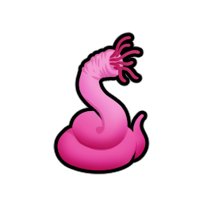
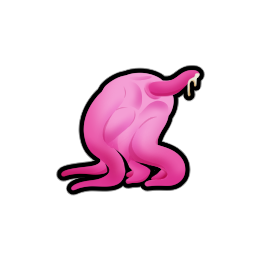

| **Category** | **Type** | **Name** | **Graphic** | **Path** | **Notes** |
| ---------- | ---------- | ---------- | ---------- | ---------- | ---------- |
| Tentacle | Neutral | Squirmer |  | `Textures/Things/Pawns/Squirmer` | |
| Tentacle | Neutral | Larva |  | `Textures/Things/Pawns/Larva` | |
| Tentacle | Neutral | Womb | NYI | NYI | |
| Tentacle | Male | Striker |  | `Textures/Things/Pawns/Grabber` | Needs rename. Has parts for attachments already created. Keep color? |
| Tentacle | Male | Abductor | NYI | NYI | Maybe purple? Keep male/female color theming? Should feel lanky and nimble. |
| Tentacle | Male | Grazer | NYI | NYI | Maybe purple? Keep male/female color theming? Should feel big and bulky; very much a herd animal. |
| Tentacle | Male | Defender | NYI | NYI | Maybe purple? Keep male/female color theming? Should feel like dangerous and powerful; very much like the Alien Xenomorph Warrior stage. |
| Tentacle | Female | Hunter |  | `Textures/Things/Pawns/Warrior` | Needs rename. Otherwise, pretty solid. |
| Tentacle | Female | Producer | NYI | NYI | |
| Tentacle | Female | Brewer | NYI | NYI | |
| Tentacle | Female | Spawner |  | `Textures/Things/Pawns/Matron` | Needs rename. Otherwise, seems about right for a Squirmer producer. |
| Tentacle | Female | Brood Mother |   | `Textures/Things/Pawns/Parts/LadyBrood` | Not sure why these were split up, but they look like an excellent base for the Brood Mother. Has monstercute sexy feels. |
| Material | Natural | Hard Resin |   | `Textures/Things/Items/HardRes` | |
| Material | Natural | Soft Resin |   | `Textures/Things/Items/SoftRes` | |
| Material | Natural | Soft Flesh | NYI | NYI | Currently using a leather recolor. Something custom would be nice. |
| Material | Natural | Tentacle Slime | NYI | NYI | Currently using a "slime food" texture from the original mod. |
| Drugs | Natural | Amornuum | NYI | NYI | Currently reusing beer texture. Something custom would be nice. |
| Buildings | Defensive | Turret |   | `Textures/Things/Buildings/Turret` | I believe a better-looking one was drafted. |
| Buildings | Defensive | Paralysis Trap | NYI | NYI | |
| Buildings | Utility | Calor |  | `Textures/Things/Buildings/Heater` | Needs rename, maybe rotations? |
| Buildings | Utility | Frigis |  | `Textures/Things/Buildings/Heater` | Needs rename, maybe rotations? |
| Equipment | Weapons | Tentacle Whip | NYI | NYI | |
| Equipment | Weapons | Resin Sword | NYI | NYI | |
| Equipment | Armor | Bodysuit | NYI | NYI | |
| Equipment | Armor | Cuirass | NYI | NYI | |
| Equipment | Armor | Helmet | NYI | NYI | |
| Equipment | Armor | Powered Armor | NYI | NYI | |
| Equipment | Armor | Powered Helmet | NYI | NYI | |
| Abilities | Animal | Genital Latch | NYI | NYI | |
| Abilities | Animal | Larval Transformation | NYI | NYI | Will eventually want one for each type of Tentacle evolution (everything except Brood Mother). |
| Abilities | Animal | Crawl Inside (Squirmer Only) |  | `Textures/Abilities` | |
| Abilities | Host | Ingest Tentacle |  | `Textures/Abilities` | |
| Abilities | Host | Expel Tentacle |  | `Textures/Abilities` | |
| Abilities | Host | Transfer Tentacle |  | `Textures/Abilities` | |
| Abilities | Host | Slime Spray | NYI | NYI | |
| Abilities | Host | Seduction Kiss | NYI | NYI | |
| Abilities | Host | Create Amor Womb | NYI | NYI | |
| Abilities | Host | Invisibility | NYI | NYI | |

NOTES:
* For Host type pawns, some sort of partial graphic specific to the type might be appropriate.  For example, some sort of tentacle body growth overlay, and (for the Queen) a head crest?
* Ideology stuff will require some research on what exactly is required.  There's already some stuff created, but it looks unfinished.  Save this for later.
* Host transformation eggs will also want some sort of graphic.  There's several sizes already created; we'll want to rework this.
